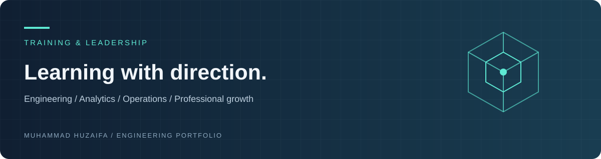

# Training, Certifications & Leadership

A curated index of my learning in engineering, analytics, operations, and professional development. Open the linked documents for the exact course title, issuer, and credential details.

## Engineering, quality, and operations

- [SolidWorks training](https://github.com/huzaifaalvi19-source/Certifications/blob/main/SOLIDWORKS%20CERT.jpeg)
- [Six Sigma Green Belt — Kennesaw State University](https://github.com/huzaifaalvi19-source/Certifications/blob/main/Six%20Sigma%20Green%20Belt%20~%20Kennesaw%20State%20University.pdf)
- [Six Sigma Green Belt — course completion](https://github.com/huzaifaalvi19-source/Certifications/blob/main/CertificateOfCompletion_Six%20Sigma%20Green%20Belt.pdf)
- [Operations Research: Models and Applications](https://github.com/huzaifaalvi19-source/Certifications/blob/main/Operations%20Research%20(1)_%20Models%20and%20Applications%20~%20National%20Taiwan%20University.pdf)
- [Supply Chain Logistics — Rutgers](https://github.com/huzaifaalvi19-source/Certifications/blob/main/Coursera%20~%20Supply%20chain%20Logistics%20-Rutgers%20State%20University.pdf)
- [Google Project Management](https://github.com/huzaifaalvi19-source/Certifications/blob/main/Coursera%20~%20Google%20Project%20Management.pdf)

## Data analytics and machine learning

- [Google Data Analytics](https://github.com/huzaifaalvi19-source/Certifications/blob/main/Coursera%20~%20Google%20Data%20Analytics.pdf)
- [IBM Data Analysis](https://github.com/huzaifaalvi19-source/Certifications/blob/main/IBM%20Data%20Analysis%20Professional%20Certificate.pdf)
- [Machine Learning with Python](https://github.com/huzaifaalvi19-source/Certifications/blob/main/Coursera%20~%20Machine%20Learning%20with%20Python.pdf)
- [DeepLearning.AI coursework](https://github.com/huzaifaalvi19-source/Certifications/blob/main/Coursera%20-%20Deep%20Learniing.AI.pdf)
- [Microsoft Azure Machine Learning Fundamentals](https://github.com/huzaifaalvi19-source/Certifications/blob/main/CertificateOfCompletion_Microsoft%20Azure%20Machine%20Learning%20Fundamentals.pdf)
- [What Is Data Science? — IBM](https://github.com/huzaifaalvi19-source/Certifications/blob/main/IBM%20~%20What%20is%20Data%20Science.pdf)
- [Data: What It Is, What We Can Do With It](https://github.com/huzaifaalvi19-source/Certifications/blob/main/Data%20%E2%80%93%20What%20It%20Is%2C%20What%20We%20Can%20Do%20With%20It%20~%20John%20Hopkins%20University.pdf)

## Sustainability and professional development

- [Sustainable Development Goals — University of Copenhagen](https://github.com/huzaifaalvi19-source/Certifications/blob/main/Coursera%20~%20SDG%20-%20Uni%20of%20Copenhagen.pdf)
- [Career Success and Daily Wins](https://github.com/huzaifaalvi19-source/Certifications/blob/main/CertificateOfCompletion_Nano%20Tips%20for%20Career%20Success%20and%20Daily%20Wins%20with%20Shade%20Zahrai.pdf)

## Leadership development

[Aspire Leaders Program — Aspire Institute](https://github.com/huzaifaalvi19-source/Certifications/tree/main/Aspire%20Leaders%20Program%20-%20Harvard%20Business%20School)

Selected as one of **9,362 finalists from 45,228 participants** in Cohort 4 (2025). The program covered leadership, professional development, problem-solving, and community impact, including resources co-created with Harvard Business School. The folder includes the completion certificate, acknowledgement letter, and module badge.

## Industrial experience evidence

Internship and employment certificates are indexed in [Professional Work Experience](https://github.com/huzaifaalvi19-source/Professional-Work-Experience).

Course-completion certificates are presented as training evidence; they do not imply an academic degree or an independently examined professional certification.

---

[Portfolio](https://huzaifaalvi19-source.github.io/Personal-Portfolio/) · [Research](https://github.com/huzaifaalvi19-source/Research-Publications) · [Projects](https://github.com/huzaifaalvi19-source/Selected-Bsc-Industrial-Engineering-Semester-Projects) · [LinkedIn](https://www.linkedin.com/in/muhammad-huzaifa-c1a2t3) · [ORCID](https://orcid.org/0009-0008-8113-1315)
